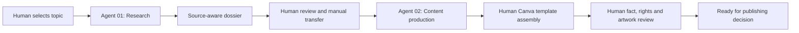

# Workflow and handoff architecture

## System boundary

Two separately configured plugins operate within a **human-directed sequence**. The project is not a connected two-agent runtime or a scheduler. There is no asserted shared state, event bus, API communication, autonomous tool invocation between plugins, or automated publication.

## Input/output agreement

| Stage | Input | Output | Human checkpoint |
| --- | --- | --- | --- |
| Topic selection | Subject, context, publishing objective | Research brief | Scope, relevance |
| Agent 01 | Brief and accessible sources | Evidence-led dossier | Claim verification and gaps |
| Manual handoff | Dossier | Selected, preserved context for Agent 02 | Transfer of `Fxx`/`Vxx` and caveats |
| Agent 02 | Dossier + requested format | Final text, images or sourced visual references where available | Narrative, fidelity, quality |
| Canva design | Agent 02 output + Manto12FC template | Manually composed slides / artwork | Typography, placement, cropping, visual consistency |
| Editorial approval | Designed artwork + draft + sources/rights | Approved / revision requested | Fact-check, credits, assets, publishing decision |

## Manual visual-production stage

**Canva is not connected to the plugins.** After receiving the texts and any available visuals/references from Agent 02, the creator manually selects suitable assets and applies them to a pre-existing Manto12FC design template in Canva. The creator is responsible for image licensing/credits, typography, proportions, cropping, final adjustments, and exporting the design. This is not automated image placement or a software integration. See [Canva production](canva-production.md).

## Deep-research handoff fields

The documented dossier contract contains nine groups, proportional to the complexity of the story:

1. **Identity and dates:** story ID, category, historical event date, opportunity date, planned publication date, and actual publication if known.
2. **Angle and relevance:** why this is worth telling; unresolved research questions.
3. **Supported synopsis:** relevant facts and caveats, not ready-to-post copy.
4. **Evidence-rich context:** chronology, actors, substantiated relations and cultural background.
5. **Fact ledger (`Fxx`):** claim, directly relevant source, source type, verification state, interpretation limit.
6. **Conflicts and limits:** what cannot be asserted without stronger sourcing.
7. **Visual ledger (`Vxx`):** specific candidate, linked facts, original source, photographer/credit, license or usage-status, alternatives.
8. **Possible angles:** options for storytelling, not a predetermined sequence of cards.
9. **Readiness and pending actions:** ready / ready with caveats / further research needed.

### Fact-versus-visual distinction

`F03` might document an event. `V02` might point to an archival photograph said to depict the event. They are separate objects: neither establishes the other's authenticity or publishing rights without further verification.

## Rules at the boundary

- Keep all substantive caveats for facts selected in the eventual publication.
- Resolve current-news status against the time of writing; a dated dossier may go stale.
- Distinguish a search lead from an examined primary source.
- Do not automatically promote a visual reference into an authorized image asset.
- Permit the editor to choose a different narrative angle without changing the supporting evidence.
- If a dossier is incomplete, label unknowns rather than fabricate missing fields.

See also [quality and limitations](quality-and-limits.md).
